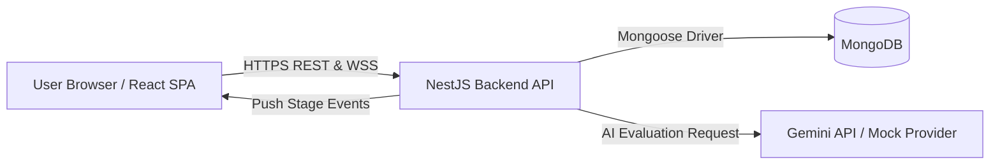

# ShortList

A hiring and candidate tracking web application with AI resume scoring and real-time updates.

Formerly CogniHire.

<!-- add screenshot here -->

## About

Hiring teams often spend hours sorting through resumes, tracking applicants in messy spreadsheets, and drafting interview notes. ShortList gives recruiters a single dashboard to post jobs, review applicants, and move candidates through hiring stages, while candidates get a simple portal to apply and follow their application status. I built this project to learn how to build and secure a full-stack system with role-based access, real-time events, and document parsing.

## Features

- **Job posting**: Recruiters can create, publish, and close job postings with role requirements and salary ranges.
- **Job applications**: Candidates can browse open positions, submit applications, and track their progress.
- **CV upload and parsing**: Candidates can upload PDF resumes, which are verified by file size and magic bytes before text extraction.
- **AI resume scoring**: Evaluates resumes against job requirements using Google Gemini (or a built-in mock provider for local testing) and provides a score with strengths and gaps.
- **Hiring pipeline stages**: Recruiters can advance candidate applications across stages (applied, screened, interview scheduled, offered, hired, rejected).
- **Real-time notifications**: Socket.IO sends alerts to users when application stages change or interviews are scheduled.
- **Job statistics**: Aggregation pipelines calculate applicant counts and stage breakdowns for each job posting.

## Tech Stack

| Component | Technology | Description |
| :--- | :--- | :--- |
| **Frontend** | React 18, Vite, TypeScript | SPA with React Router, Zustand for state, and Lucide icons |
| **Backend** | NestJS 10, Node.js 22, Express | Modular TypeScript API with class-validator and DTOs |
| **Database** | MongoDB 7, Mongoose | Document database with custom schema validations and aggregations |
| **Real-time** | Socket.IO | WebSockets with JWT handshake authentication |
| **DevOps** | Docker, Docker Compose | Multi-stage slim Alpine images running as non-root (`node`) |
| **Testing & CI** | Jest, Supertest, GitHub Actions | 24 Jest test suites (133 tests), CodeQL, Dependabot |

## How It Works



1. Candidates view published jobs and submit an application with their PDF resume.
2. The NestJS backend validates the upload, extracts resume text, and calls the AI service to score qualifications against job requirements.
3. Recruiters review scored candidates in the dashboard and update application stages.
4. MongoDB stores users, jobs, applications, interview notes, and audit logs.
5. Socket.IO pushes notifications directly to the candidate browser session.

## Getting Started

### Requirements
- Node.js 20+ (tested on Node.js 22)
- Docker and Docker Compose (tested on Docker 29.x and Compose v5.x)
- Git

### Run with Docker
1. Clone the repository and navigate into the folder:
```bash
git clone https://github.com/Mustafa-Hazard/ShortList.git
cd ShortList
```

2. Create your environment file from the template:
```bash
cp .env.example .env
```

3. Build and start the containers:
```bash
docker compose up --build -d
```

4. Seed the database with test accounts and a sample job:
```bash
docker compose exec backend node dist/seed.js
```

The frontend runs at `http://localhost:5173` and the backend API runs at `http://localhost:3000`.

### Run without Docker
To run directly on your host machine, you will need a running MongoDB instance. You can start the database container with local host binding:
```bash
docker compose -f docker-compose.yml -f docker-compose.dev.yml up -d db
```

1. Create your environment file:
```bash
cp .env.example .env
```
*(Update `MONGODB_URI` in `.env` to connect to `127.0.0.1:27017`)*

2. Start the backend:
```bash
cd backend
npm install
npm run build
npm run seed
npm run start:dev
```

3. Start the frontend in a separate terminal:
```bash
cd frontend
npm install
npm run dev
```

### Environment Variables

| Variable | Description | Example / Default |
| :--- | :--- | :--- |
| `PORT` | HTTP port for the NestJS API | `3000` |
| `FRONTEND_PORT` | Port for the Vite frontend server | `5173` |
| `NODE_ENV` | Environment mode (`development` or `production`) | `production` |
| `CORS_ORIGIN` | Allowed web frontend origin for CORS | `http://localhost:5173` |
| `MONGO_USER` | MongoDB admin username | `shortlist` |
| `MONGO_PASSWORD` | MongoDB admin password | `shortlist_secure_dev_pass_123` |
| `MONGO_DB` | MongoDB database name | `shortlist` |
| `MONGODB_URI` | MongoDB connection string | `mongodb://shortlist:shortlist_secure_dev_pass_123@db:27017/shortlist?authSource=admin` |
| `JWT_ACCESS_SECRET` | Secret key for access tokens (minimum 32 characters) | `shortlist_super_secret_jwt_access_token_key_at_least_32_characters` |
| `JWT_REFRESH_SECRET` | Secret key for refresh tokens (minimum 32 characters) | `shortlist_super_secret_jwt_refresh_token_key_at_least_32_characters` |
| `JWT_ACCESS_EXPIRES_IN` | Validity duration of access tokens | `15m` |
| `JWT_REFRESH_EXPIRES_IN` | Validity duration of refresh tokens | `7d` |
| `AI_PROVIDER` | AI engine mode: `mock` (zero-config testing) or `gemini` | `mock` |
| `GEMINI_API_KEY` | API key from Google AI Studio (required if `AI_PROVIDER=gemini`) | `dummy_mock_key_for_testing` |
| `GEMINI_MODEL` | Google Gemini model identifier | `gemini-1.5-flash` |
| `MAX_CV_SIZE_MB` | Maximum allowed CV file upload size in megabytes | `5` |
| `UPLOAD_DIR` | Local storage directory for uploaded resumes | `/app/uploads/cvs` |

### Demo Accounts
The following accounts are generated by `backend/src/seed.ts` for local testing only. Never use these credentials in a public or production environment.

All seeded accounts use password: `Password123!`

| Role | Email | Purpose |
| :--- | :--- | :--- |
| Admin | `admin@acme.com` | Full tenant management and user access |
| Recruiter | `recruiter@acme.com` | Create jobs, review applicants, and score CVs |
| Hiring Manager | `hiring@acme.com` | Review shortlisted candidates and schedule interviews |
| Candidate | `candidate@example.com` | Browse open listings and submit applications |

## Running Tests

### Backend Unit and Integration Tests
```bash
cd backend
npm test
```
Runs 24 Jest test suites covering authentication, NoSQL sanitization, rate limiting, file upload validation, role guards, services, and controllers (133 total tests passing).

### Backend Linting
```bash
cd backend
npm run lint
```
Checks backend TypeScript code formatting and lint rules.

### Frontend Production Build
```bash
cd frontend
npm run build
```
Type-checks TypeScript files and compiles the React production bundle using Vite.

## Project Structure

```text
.
├── backend/            # NestJS API application and business logic
│   ├── src/            # Controllers, services, schemas, and guards
│   └── test/           # End-to-end and integration test configuration
├── frontend/           # React 18 single-page application
│   ├── src/            # Components, pages, router, and Zustand stores
│   └── public/         # Static web assets
├── docs/               # System architecture and data privacy reference docs
├── .github/            # GitHub Actions CI, CodeQL, and Dependabot workflows
├── docker-compose.yml  # Production multi-stage Docker deployment setup
└── docker-compose.dev.yml # Local development overlay for MongoDB port binding
```

## Security

- **Helmet HTTP headers**: Secures HTTP response headers against clickjacking, MIME sniffing, and cross-site scripting.
- **Strict CORS policy**: Rejects requests from unauthorized origins and forbids wildcard origins when credentials are sent.
- **Rate limiting**: Guards public routes with `@nestjs/throttler`, enforcing strict rate limits on login and registration endpoints.
- **Global validation pipe**: Strips non-whitelisted request payload properties and transforms types using `class-validator`.
- **NoSQL injection defense**: Inspects incoming request bodies and query parameters to strip or reject `$` operators and dotted paths.
- **Password hashing**: Uses `bcrypt` with salt rounds to store salted password hashes rather than plaintext.
- **JWT authentication**: Requires access and refresh tokens signed with distinct, validated secrets of at least 32 characters.
- **Role-based access control**: Restricts endpoints by user role (admin, recruiter, hiring manager, candidate) using custom NestJS guards.
- **Object-level permission checks**: Verifies that candidates can only access their own applications, resumes, and interview feedback.
- **Secure file uploads**: Restricts CV uploads to 5 MB, verifies the `%PDF-` file magic bytes, and generates sanitized filenames to prevent path traversal.
- **Production error masking**: Hides database connection strings and internal stack traces from clients via a global exception filter.
- **Authenticated WebSockets**: Validates JWT bearer tokens during Socket.IO handshakes and isolates users to private notification rooms.
- **Non-root Docker containers**: Runs both backend and frontend images under the unprivileged `node` user with read-only root filesystems and dropped Linux capabilities.
- **Automated CI scanning**: Scans dependencies and git history for vulnerabilities and secret leaks using CodeQL, npm audit, and Gitleaks.

## What I Learned and What I Would Improve Next

- **Migrating from relational to document storage**: Moving from PostgreSQL to MongoDB taught me how to write MongoDB aggregation pipelines for stage statistics while keeping relational integrity through explicit ID references.
- **Handling external AI failures**: Large language models can experience rate limits or network hiccups, so designing a mock fallback provider was essential for reliable testing and local development.
- **Defense in depth for file uploads**: Validating MIME types alone is not enough; reading magic bytes from file buffers ensures uploaded files are genuine PDFs.
- **What is still missing**: I would like to add an asynchronous job queue (such as BullMQ with Redis) for background resume processing and implement cloud object storage for uploaded files instead of local volume mounts.

## Contributing and License

- Guidelines for contributing can be found in [CONTRIBUTING.md](CONTRIBUTING.md).
- Security policy and reporting instructions are documented in [SECURITY.md](SECURITY.md).
- This project is open source and available under the [MIT License](LICENSE).

## Author

Mustafa Muhammad Iqbal
- GitHub: [github.com/Mustafa-Hazard](https://github.com/Mustafa-Hazard)
- LinkedIn: [linkedin.com/in/mustafa642](https://www.linkedin.com/in/mustafa642)
